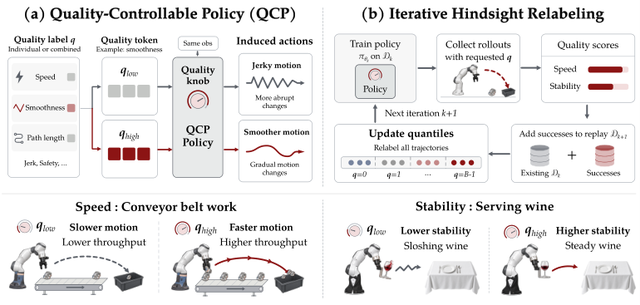
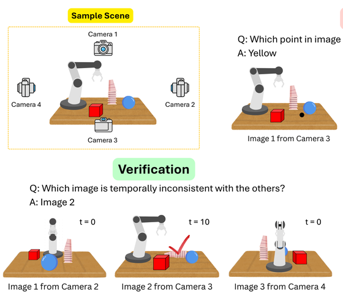
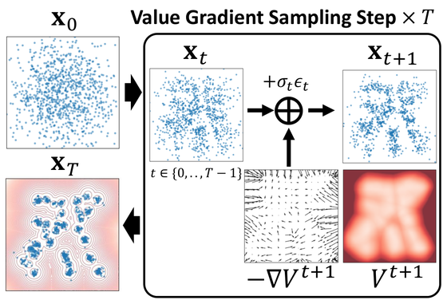
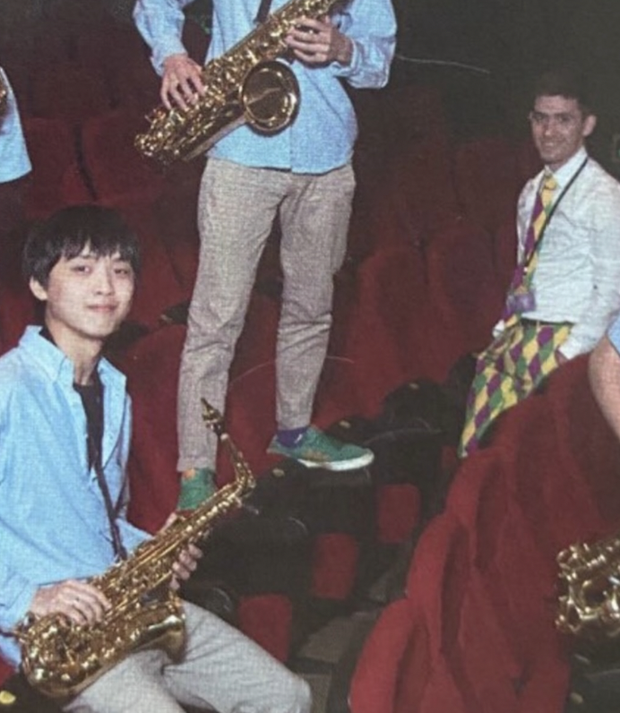

Hi, I'm a master's student at KAIST AI, advised by Prof. <a href="https://sites.google.com/view/kiminlee">Kimin Lee</a>.
I received B.S. degrees in Mechanical Engineering and Artificial Intelligence from Seoul National University in August 2026.
My research focuses on sequential decision-making, reinforcement learning, and robot learning from human data, with a particular interest in natural human–robot interaction.

  <a href="mailto:dkshin99@gmail.com">Email</a>
  &nbsp;/&nbsp;
  <a href="https://www.linkedin.com/in/dkshin99">LinkedIn</a>
  &nbsp;/&nbsp;
  <a href="https://github.com/DonkeyU99">GitHub</a>

## Research Interests

- Reinforcement Learning & Sequential Decision Making
- Robotics & Robot Manipulation
- Human–Robot Interaction and Human-to-Robot Transfer

## Education

  

    

      <strong>Korea Advanced Institute of Science and Technology (KAIST)</strong> 
      M.S. in Artificial Intelligence 
      Advisor: <a href="https://sites.google.com/view/kiminlee">Kimin Lee</a>
    

    
Sep. 2026 – Present

  

  

    

      <strong>Seoul National University (SNU)</strong> 
      B.S. in Mechanical Engineering 
      B.S. in Interdisciplinary Major in Artificial Intelligence
    

    
Mar. 2019 – Aug. 2026

  

  

    

      <strong>Shanghai Community International School</strong>
    

    
May 2015 – May 2018

  

## Research & Professional Experience

  

    

      <strong>KAIST AI · RISE Lab</strong> 
      Master's Student (Sep. 2026 – Present) 
      Research Intern (Aug. 2025 – Aug. 2026)
    

    
Aug. 2025 – Present

  

  
Advisor: Kimin Lee

  <ul>
    <li>Human-to-Robot Transfer and Human–Robot Interaction</li>
    <li>Learning robot policies from human observations</li>
  </ul>

  

    

      <strong>SNU Robotics Laboratory</strong> 
      Undergraduate Thesis
    

    
Aug. 2024 – Jun. 2025

  

  
Advisor: Frank Chongwoo Park

  <ul>
    <li>SE(3)-equivariant grasp pose generation</li>
    <li>Rectified flow models for 6-DoF grasp sampling</li>
  </ul>

  

    

      <strong>SNU Robotics Laboratory</strong> 
      Undergraduate Research Program
    

    
Jun. 2023 – Oct. 2023

  

  
Advisor: Frank Chongwoo Park

  <ul>
    <li>Anomaly detection with hyperspherical embedding on a ViT backbone</li>
  </ul>

  

    

      <strong>Republic of Korea Army</strong> 
      Mandatory Military Service
    

    
Feb. 2021 – Jul. 2022

  

  <ul>
    <li>Discharged as Army Sergeant (Ammunition Management)</li>
  </ul>

## Publications

Publication Type — C: Conference | J: Journal | P: Preprint (* equal contribution, † co-corresponding authors)

  
  

    
[P2] Learning Quality-Controllable Robot Policies with Iterative Hindsight Relabeling

    
Sinjae Kang, <strong>Dong Kyu Shin</strong>, Jaehong Kim, Kamin Lee, Hyoeun Kim, Kaixin Wang, Li Zhao, Seonghyeon Ye†, Kimin Lee†

    
Under review / ArXiv Preprint, 2026

    

      <a href="https://sinnnj.github.io/qcp/">project page</a>
      /
      <a href="https://arxiv.org/abs/2610.37393">arXiv</a>
    

    
A quality-controllable robot policy that steers execution attributes such as speed and smoothness at inference time, then expands that range beyond demonstrations through iterative hindsight relabeling.

  

  
  

    
[P1] EDITH: Hierarchical Policies from Verbal and Egocentric Human Signals for Natural Human–Robot Interaction

    
Dongjun Lee*, Juheon Choi*, <strong>Dong Kyu Shin*</strong>, Sinjae Kang, Kimin Lee

    
Under review / ArXiv Preprint, 2026

    

      <a href="https://project-edith.github.io">project page</a>
      /
      <a href="https://arxiv.org/abs/2606.10276">arXiv</a>
    

    
A hierarchical policy framework that learns natural human–robot interaction from verbal and egocentric human signals, enabling robots to interpret spoken instructions and first-person visual cues for grounded, intuitive collaboration.

  

  
  

    
[C2] Learning Multi-View Spatial Reasoning from Cross-View Relations

    
Suchae Jeong*, Jaehwi Song*, Haeone Lee, Hanna Kim, Jian Kim, Dongjun Lee, <strong>Dong Kyu Shin</strong>, Changyeon Kim, Dongyoon Hahm, Woogyeol Jin, Juheon Choi, Kimin Lee†

    
<strong>CVPR</strong> 2026

    

      <a href="https://cross-view-relations.github.io/">project page</a>
      /
      <a href="https://arxiv.org/abs/2603.27967">arXiv</a>
      /
      <a href="https://github.com/cross-view-relations/cross-view-relations">code</a>
    

    
A large-scale dataset of 100K multi-view VQA samples that teaches VLMs spatial reasoning across viewpoints—correspondence, verification, and localization—and transfers those representations to robotic manipulation.

  

  
  

    
[C1] Value Gradient Sampler: Learning Invariant Value Functions for Equivariant Diffusion Sampling

    
Himchan Hwang*, Hyeokju Jeong*, <strong>Dong Kyu Shin*</strong>, Che-Sang Park, Sehee Kweon, Sangwoong Yoon†, Frank Chongwoo Park†

    
<strong>AISTATS</strong> 2026

    

      <a href="https://arxiv.org/abs/2502.13280">arXiv</a>
      /
      <a href="https://github.com/swyoon/value-gradient-sampler">code</a>
    

    
A diffusion sampler parameterized by invariant value functions, inducing equivariant gradient flows without equivariant architectures and combining RL training with efficient invariant networks for high-quality particle sampling.

  

## Selected Projects

  

    
RC-Car Autonomous Racing Challenge

    
2024

    

      <a href="https://www.youtube.com/watch?v=zlIGfZmXp-g">video</a>
    

    
Modified PPO-based reinforcement learning for autonomous racing on unknown tracks, using Python, ROS2, and MuJoCo.

  

## Technical Skills

**Programming:** Python (PyTorch, OpenGL), MATLAB, C++, ROS2  
**Languages:** Korean (Native), English (Intermediate), Mandarin Chinese (Conversational), French (Beginner)

## Awards and Honors

  Science and Engineering Scholarship, <em>Ministry of Science and ICT</em>
  Sept 2023 – Feb 2025

  2nd Place, RC-Car Autonomous Racing Challenge
  Dec 2024

  Bronze Medal, Mechatronics Project Contest, <em>Hyundai Infracore</em>
  Jun 2023

  Academic Excellence Scholarship
  Mar 2023 – Aug 2023

  Academic Excellence Scholarship
  Mar 2019 – Feb 2021

## Hobbies

  

    <h3>Saxophone</h3>
    
I enjoy playing the saxophone in my free time. Learning and performing improvisation is one of the most creatively fulfilling parts of my life.

    <a href="https://www.youtube.com/watch?v=UTBj_NCl4YA" target="_blank" rel="noopener noreferrer" class="performance-link">View Performances</a>
  

  

<em>Last updated: November 2026</em>

