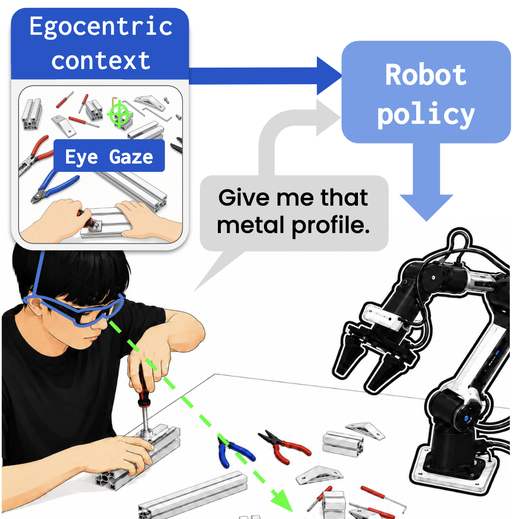

## Contact Info

 - **Email:** [dkshin99@gmail.com](mailto:dkshin99@gmail.com)
 - **LinkedIn:** [Click](https://www.linkedin.com/in/dkshin99)
 - **GitHub:** [Click](https://github.com/DonkeyU99)
 - **Google Scholar:** [Click](https://scholar.google.com/citations?user=XXXX)
 - **CV:** [Click]()

---

## About Me

Hi, I'm a master's student at KAIST AI, advised by Prof. [Kimin Lee](https://sites.google.com/view/kiminlee). I received B.S. degrees in Mechanical Engineering and Artificial Intelligence from Seoul National University in August 2026. My research focuses on sequential decision-making, reinforcement learning, and robot learning from human data, with a particular interest in natural human–robot interaction.

---

## Research Interests

- **Reinforcement Learning & Sequential Decision Making**
- **Robotics & Robot Manipulation**
- **Human–Robot Interaction and Human-to-Robot Transfer**

---

## Education

  

    

      <strong>Korea Advanced Institute of Science and Technology (KAIST)</strong> 
      M.S. in Artificial Intelligence 
      Advisor: <a href="https://sites.google.com/view/kiminlee">Kimin Lee</a>
    

    
Sep. 2026 – Present

  

  

    

      <strong>Seoul National University (SNU)</strong> 
      B.S. in Mechanical Engineering 
      B.S. in Interdisciplinary Major in Artificial Intelligence 
    

    
Mar. 2019 – Aug. 2026

  

  

    

      <strong>Shanghai Community International School</strong>
    

    
May 2015 – May 2018

  

---

## Research & Professional Experience

  

    

      <strong>KAIST AI · RISE Lab</strong> 
      Master's Student (Sep. 2026 – Present) 
      Research Intern (Aug. 2025 – Aug. 2026)
    

    
Aug. 2025 – Present

  

  
Advisor: Kimin Lee

  <ul>
    <li>Conducting research on <strong>Human-to-Robot Transfer</strong> and <strong>Human–Robot Interaction</strong></li>
    <li>Investigating how human observations can enhance robot learning capabilities</li>
  </ul>

  

    

      <strong>SNU Robotics Laboratory</strong> 
      Undergraduate Thesis
    

    
Aug. 2024 – Jun. 2025

  

  
Advisor: Frank Chongwoo Park

  <ul>
    <li>Developed <strong>SE(3)-equivariant grasp pose generation</strong> methods</li>
    <li>Applied <strong>rectified flow models</strong> to 6-DoF grasp sampling</li>
  </ul>

  

    

      <strong>SNU Robotics Laboratory</strong> 
      Undergraduate Research Program
    

    
Jun. 2023 – Oct. 2023

  

  
Advisor: Frank Chongwoo Park

  <ul>
    <li>Studied anomaly detection algorithms</li>
    <li>Implemented <strong>hyperspherical embedding with ViT backbone</strong>, achieving SOTA-comparable performance</li>
  </ul>

  

    

      <strong>Republic of Korea Army</strong> 
      Mandatory Military Service
    

    
Feb. 2021 – Jul. 2022

  

  <ul>
    <li>Discharged as <strong>Army Sergeant</strong> (Ammunition Management)</li>
  </ul>

---

## Publications

(* equal contribution, † co-corresponding authors)

  
  

    
EDITH: Hierarchical Policies from Verbal and Egocentric Human Signals for Natural Human–Robot Interaction

    
Dongjun Lee*, Juheon Choi*, <strong>Dong Kyu Shin*</strong>, Sinjae Kang, Kimin Lee

    
Under review / ArXiv Preprint, 2026

    

      <a href="https://project-edith.github.io">project page</a>
      /
      <a href="https://arxiv.org/abs/2606.10276">arXiv</a>
    

    
A hierarchical policy framework that learns natural human–robot interaction from verbal and egocentric human signals, enabling robots to interpret spoken instructions and first-person visual cues for grounded, intuitive collaboration.

  

  
  

    
Learning Multi-View Spatial Reasoning from Cross-View Relations

    
Suchae Jeong*, Jaehwi Song*, Haeone Lee, Hanna Kim, Jian Kim, Dongjun Lee, <strong>Dong Kyu Shin</strong>, Changyeon Kim, Dongyoon Hahm, Woogyeol Jin, Juheon Choi, Kimin Lee†

    
<strong>CVPR</strong> 2026

    

      <a href="https://cross-view-relations.github.io/">project page</a>
      /
      <a href="https://arxiv.org/abs/2603.27967">arXiv</a>
      /
      <a href="https://github.com/cross-view-relations/cross-view-relations">code</a>
    

    
A large-scale dataset of 100K multi-view VQA samples that teaches VLMs spatial reasoning across viewpoints—correspondence, verification, and localization—and transfers those representations to robotic manipulation.

  

  
  

    
Value Gradient Sampler: Learning Invariant Value Functions for Equivariant Diffusion Sampling

    
Himchan Hwang*, Hyeokju Jeong*, <strong>Dong Kyu Shin*</strong>, Che-Sang Park, Sehee Kweon, Sangwoong Yoon†, Frank Chongwoo Park†

    
<strong>AISTATS</strong> 2026

    

      <a href="https://arxiv.org/abs/2502.13280">arXiv</a>
      /
      <a href="https://github.com/swyoon/value-gradient-sampler">code</a>
    

    
A diffusion sampler parameterized by invariant value functions, inducing equivariant gradient flows without equivariant architectures and combining RL training with efficient invariant networks for high-quality particle sampling.

  

---

## Selected Projects

  

    
RC-Car Autonomous Racing Challenge

    
2024

    

      <a href="https://www.youtube.com/watch?v=zlIGfZmXp-g">video</a>
    

    
Modified PPO-based reinforcement learning for autonomous racing on unknown tracks, using Python, ROS2, and MuJoCo.

  

---

## Technical Skills

**Programming Languages:** Python (PyTorch, OpenGL), MATLAB, C++, ROS2  
**Languages:** Korean (Native), English (Intermediate), Mandarin Chinese (Conversational), French (Beginner)

---

## Awards and Honors

- **Science and Engineering Scholarship**  
  *Ministry of Science and ICT* (Sept 2023 – Feb 2025)
- **2nd Place**, RC-Car Autonomous Racing Challenge  
  (Dec 2024)
- **Bronze Medal**, Mechatronics Project Contest  
  *Hyundai Infracore* (Jun 2023)
- **Academic Excellence Scholarship**  
  (Mar 2023 – Aug 2023)
- **Academic Excellence Scholarship**  
  (Mar 2019 – Feb 2021)

---

## Hobbies

  

    <h3>Saxophone</h3>
    
I enjoy playing the saxophone in my free time. Learning and performing improvisation is one of the most creatively fulfilling parts of my life.

  

  

<em>Last updated: September 2026</em>

